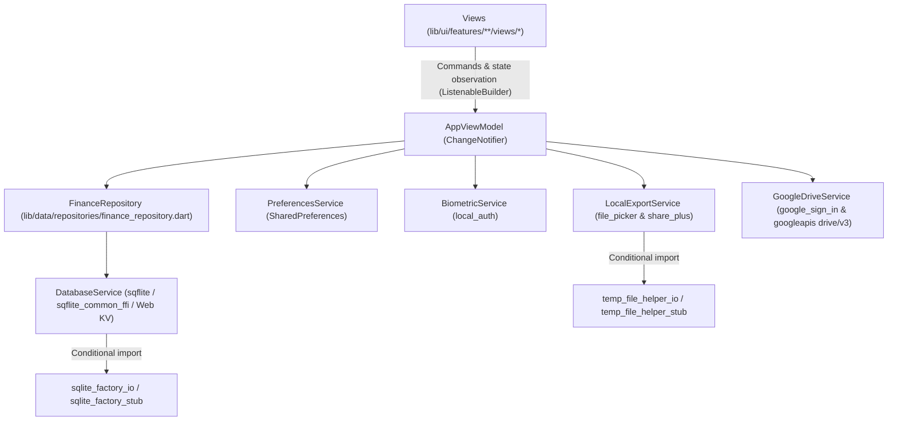
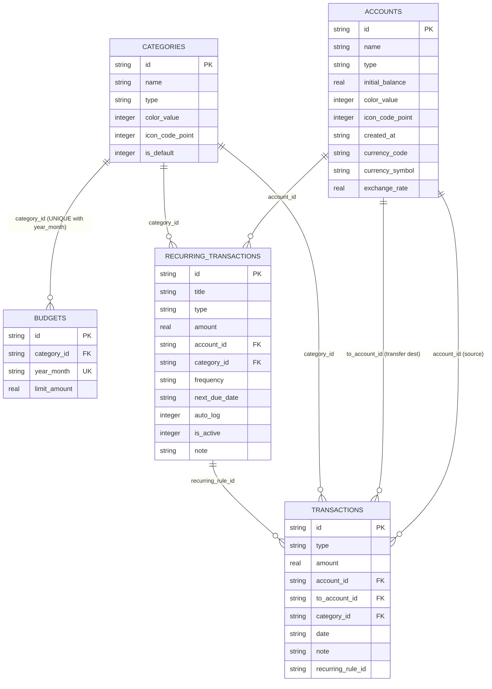
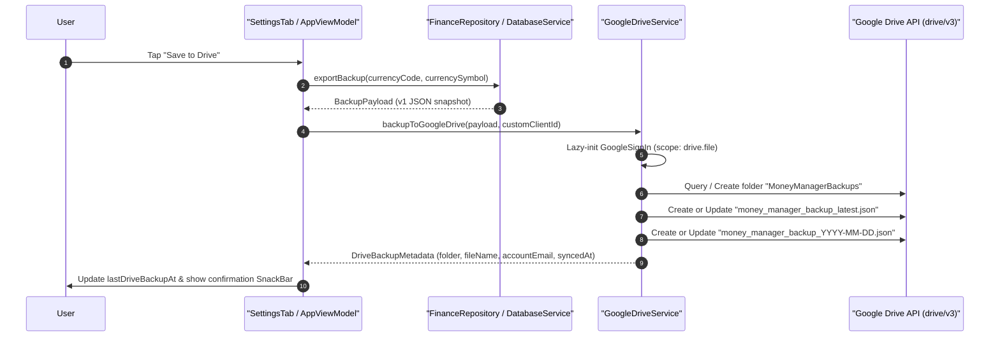

# Money Manager — Technical Specification

**Version:** `1.0.0+1`  
**Framework:** Flutter (Dart SDK `^3.14.0`, Material 3)  
**Platforms:** Android, iOS, Offline-First Web PWA  
**Storage Model:** 100% Local-First (SQLite / Web Key-Value fallback) with strictly on-demand Google Drive backup

---

## 1. System Overview & Core Invariants

Money Manager is a personal finance application built around strict local ownership and minimal resource footprint:

1. **Zero Passive Network Traffic:** Neither `AppViewModel.initialize()` nor any repository/service initializes network clients, analytics SDKs, or background sync workers on startup. `GoogleDriveService` authenticates and transmits data **only** when the user explicitly triggers backup or restore in the **Sync & Backup** screen.
2. **Minimum-Privilege Cloud Scope:** Google Drive access uses exclusively `DriveApi.driveFileScope` (`drive.file`), restricting visibility to the `MoneyManagerBackups` folder and backup files created by the app itself.
3. **Cloud Auto-Backup Disabled on Android:** `android/app/src/main/AndroidManifest.xml` explicitly sets `android:allowBackup="false"` and `android:fullBackupContent="false"` so financial records remain under explicit user-initiated export control rather than silent OS cloud backups.
4. **Offline Multi-Currency Engine:** All exchange rates (`1 <walletCode> = X <baseCode>`) are stored locally per account in SQLite, defaulting to built-in reference presets (`CurrencyOption.presets`) and editable anytime offline.

---

## 2. Architecture (MVVM)

The application uses a layered **Model–View–ViewModel (MVVM)** architecture with a single `ChangeNotifier` state coordinator (`AppViewModel`) injected at app bootstrap in `lib/main.dart`.

### Module Directory Map

| Layer | File | Responsibility |
| :--- | :--- | :--- |
| **Bootstrap** | `lib/main.dart` | Initializes Flutter bindings, wires `createDefaultAppViewModel()`, wraps `HomeShell` with `DynamicColorBuilder` and `AppTheme`. |
| **Theme & Shared UI** | `lib/ui/core/app_theme.dart` | `MoneyColors` `ThemeExtension`, Warm Alabaster light & OLED Pitch Black dark `ThemeData`, `AppTheme.tabular`, `MinimalPill`, `MinimalMonthSwitcher`, and `AppFormatters`. |
| **ViewModel** | `lib/ui/features/home/view_models/app_view_model.dart` | Holds loaded lists (`accounts`, `categories`, `transactions`, `budgets`, `recurringTransactions`), filters (`selectedMonth`, `searchQuery`, `selectedTypeFilter`, `selectedAccountFilterId`), derived summaries (`accountSummaries`, `totalNetBalance`, `ytdCashflow`, `sixMonthCashflow`, `expenseBreakdownByCategory`), lock state, and backup/export orchestration. |
| **Views** | `lib/ui/features/home/views/home_shell.dart` | `WidgetsBindingObserver` lifecycle auto-lock (`paused`/`hidden`), top `AppBar` (theme toggle, Backup shortcut, conditional Lock button), `IndexedStack` for 5 tabs, centered floating capsule dock `_MinimalBottomNav`. |
| **Views** | `lib/ui/features/home/views/overview_tab.dart` | Total Balance hero card (`In`/`Out`), inline month switcher, pill search field, type & wallet filter pills, daily-grouped `Dismissible` transaction list with native + `≈ base` readouts. |
| **Views** | `lib/ui/features/home/views/accounts_tab.dart` | Combined net worth summary card, `Transfer` & `+ Wallet` pills, unified wallet list card, `_AccountEditorDialog` with currency & offline exchange rate editor. |
| **Views** | `lib/ui/features/home/views/budgets_tab.dart` | Monthly category budget progress rows (80% warning / 100% over-budget), recurring bill rules, `_BudgetEditorDialog`, and `_RecurringEditorDialog`. |
| **Views** | `lib/ui/features/home/views/reports_tab.dart` | Monthly Net summary, YTD Cashflow summary (`Export YTD CSV`), Category Spending `PieChart` donut (`fl_chart`), switchable YTD / 6-Month `BarChart`, and month-by-month YTD rows. |
| **Views** | `lib/ui/features/home/views/settings_tab.dart` | On-demand Google Drive Backup/Restore, OS Share Sheet fallback, local JSON/CSV export & import, base currency picker, appearance picker, biometric toggle, custom categories manager, OAuth Client ID config. |
| **Views** | `lib/ui/features/home/views/transaction_form_sheet.dart` | Bottom sheet for creating/editing Expense, Income, or Transfer entries with live base-currency conversion preview. |
| **Views** | `lib/ui/features/auth/views/lock_screen.dart` | Biometric-only unlock gate (`Unlock with Biometrics`). |
| **Repository** | `lib/data/repositories/finance_repository.dart` | Delegates persistence CRUD to `DatabaseService`; implements local balance rollup, cross-currency transfers, monthly budget computation, and due recurring auto-logging. |
| **Services** | `lib/data/services/database_service.dart` | SQLite schema v2 management, v1→v2 `onUpgrade`, Web `SharedPreferences` (`mm_kv_*`) fallback, atomic restore transactions, and default seed data. |
| **Services** | `lib/data/services/preferences_service.dart` | Stores `AppSettings` (`mm_*` keys) and defines `CurrencyOption.presets` + `CurrencyOption.defaultRateToBase`. |
| **Services** | `lib/data/services/biometric_service.dart` | Wraps `local_auth` (`biometricOnly: true`, `persistAcrossBackgrounding: true`); returns `false` on Web (`kIsWeb`). |
| **Services** | `lib/data/services/google_drive_service.dart` | Lazy Google Sign-In initialization + Drive v3 REST calls to `MoneyManagerBackups/`. |
| **Services** | `lib/data/services/local_export_service.dart` | Writes/reads JSON backups (`FilePicker.saveFile` / `FilePicker.pickFile`), CSV exports (`saveTransactionsCsvToDevice`, `saveYtdCashflowCsvToDevice`), and OS share files. |
| **Platform Shims** | `sqlite_factory_{io,stub}.dart`, `temp_file_helper_{io,stub}.dart` | Conditional `dart.library.io` imports separating native desktop/mobile SQLite FFI and temp-dir file I/O from Web builds. |
| **Domain Models** | `lib/domain/models/*.dart` | Immutable value models (`Account`, `AccountSummary`, `CategoryItem`, `TransactionItem`, `Budget`, `BudgetProgress`, `RecurringTransaction`, `BackupPayload`) with dual `toMap`/`fromMap` (snake_case SQLite) and `toJson`/`fromJson` (camelCase JSON) adapters. |

---

## 3. Data Layer & Persistence

### Entity-Relationship Diagram

### Multi-Platform Storage Strategy

`DatabaseService` supports three execution targets without changing domain/UI code:

1. **Mobile (Android / iOS):** Uses native `sqflite` (`money_manager.db`, `_dbVersion = 2`) with indices on `transactions(date)`, `transactions(account_id)`, and `transactions(category_id)`.
2. **Desktop & Automated Unit Tests:** `resolveDesktopDatabaseFactory()` in `sqlite_factory_io.dart` detects Windows/Linux/macOS (`Platform.isWindows || Platform.isLinux || Platform.isMacOS`), initializes `sqflite_common_ffi`, and opens disk or `inMemoryDatabasePath` SQLite databases.
3. **Offline Web PWA (`kIsWeb`):** `DatabaseService` switches to `_forceKeyValueStore = true` (`SharedPreferences` backed by browser `localStorage` under `mm_kv_*` keys), allowing the PWA to work offline without WASM/IndexedDB SQLite binaries.

### Seed Data & Atomic Operations

- **Initial Seed:** On first launch, `_seedDefaultsInDb` / `_initKeyValueStore` creates two wallets (`acc_cash` **"Cash Wallet"** and `acc_bank` **"Main Bank"**, both initialized at `0.0`) and 12 default categories (4 income, 8 expense) in `DefaultCategories.all`.
- **Cascading Account Deletion:** `DatabaseService.deleteAccount(accountId)` executes inside `_db!.transaction(...)` removing the account, all transactions where `account_id = ? OR to_account_id = ?`, and linked recurring rules.
- **Atomic Restore:** `DatabaseService.restoreAllData(BackupPayload)` deletes and re-inserts `transactions`, `budgets`, `recurring_transactions`, `categories`, and `accounts` inside a single SQLite transaction so malformed partial states cannot be persisted.

For full DDL, JSON keys, and CSV column specifications, see [`DATA_AND_BACKUP_SCHEMA.md`](DATA_AND_BACKUP_SCHEMA.md).

---

## 4. Core Domain Algorithms

### 4.1 Offline Multi-Currency & Cross-Currency Transfers

- **Wallet-to-Base Conversion (`Account.toBaseAmount`):**  
  If `account.currencyCode` is non-empty and differs from the active `baseCurrencyCode`, `baseAmount = nativeAmount * exchangeRateToBase` (otherwise `nativeAmount`). Invalid or non-positive rates are sanitized to `1.0` in `Account.fromMap`.
- **Default Reference Rates (`CurrencyOption.defaultRateToBase`):**  
  Computes offline ratios from static USD reference anchors across 10 preset currencies (`USD`, `EUR`, `GBP`, `INR`, `JPY`, `CAD`, `AUD`, `SGD`, `IDR`, `MYR`) rounded to 4 significant digits:
  $$\text{rate}_{\text{wallet} \to \text{base}} = \frac{\text{usdPerUnit}(\text{walletCode})}{\text{usdPerUnit}(\text{baseCode})}$$
- **Cross-Currency Transfers (`FinanceRepository.computeAccountSummaries`):**  
  When transferring `tx.amount` from `fromAccount` to `toAccount`:
  - Deduct `tx.amount` in `fromAccount` native units.
  - Credit `toAccount` with `tx.amount` if currencies match, or convert via base currency:
    $$\text{credit}_{\text{dest}} = \text{tx.amount} \times \frac{\text{fromAccount.toBaseAmount}(1.0, \text{base})}{\text{toAccount.toBaseAmount}(1.0, \text{base})}$$

### 4.2 Budget Progress Evaluation

`FinanceRepository.computeMonthlyBudgets` aggregates all `TransactionType.expense` entries matching `Budget.formatYearMonth(tx.date) == yearMonth` (`YYYY-MM`), converting foreign-wallet expenses via `acc.toBaseAmount(tx.amount, baseCurrencyCode)`. Each `BudgetProgress` computes:
- `ratio = limitAmount <= 0 ? 0.0 : spentAmount / limitAmount`
- `isWarning = ratio >= 0.8 && ratio < 1.0`
- `isOverBudget = ratio >= 1.0`

Results are sorted descending by `ratio` so highest-utilization budgets surface first.

### 4.3 Startup Recurring Transaction Catch-Up

At startup, `AppViewModel.initialize()` calls `FinanceRepository.processDueRecurringTransactions()`:
- Evaluates every rule where `isActive == true && autoLog == true`.
- Generates missed entries while `!due.isAfter(endOfToday)` (`23:59:59` of today), capped by a `guard < 36` loop limit against corrupted historical dates.
- Advances `nextDueDate` via `RecurringTransaction.advanceDueDate(from)`, clamping end-of-month days (e.g., Jan 31 → Feb 28/29 via `DateTime(nextYear, nextMonth + 1, 0).day`) for `monthly` and `yearly` rules.

### 4.4 YTD & 6-Month Cashflow Analytics

In `AppViewModel`:
- `sixMonthCashflow` evaluates `[selectedMonth - 5 .. selectedMonth]`.
- `ytdCashflow` evaluates `January .. selectedMonth` of `selectedMonth.year`.
- Both share `_cashflowForMonth(DateTime target)`, converting all matching income and expense rows to base currency via `amountInBase(tx)` (excluding internal `transfer` transactions from income/expense totals).
- `ytdIncome`, `ytdExpense`, and `ytdNet` summarize the active year-to-date array and feed `exportYtdCashflowCsv()`.

---

## 5. Security, Biometrics & On-Demand Google Drive Sync

### Google Drive Sync Flow

### Biometric Lock & Platform Integration

- **Hardware Gate (`BiometricService`):** Calls `LocalAuthentication.authenticate(..., biometricOnly: true, persistAcrossBackgrounding: true)` only after verifying `isDeviceSupported()`, `canCheckBiometrics`, and non-empty `getAvailableBiometrics()`. No PIN fallback is exposed inside the app.
- **Lifecycle Auto-Lock (`HomeShell`):** Observes `WidgetsBindingObserver.didChangeAppLifecycleState`; transitions to `AppLifecycleState.paused` or `AppLifecycleState.hidden` immediately invoke `AppViewModel.lockIfEnabled()` to render `LockScreen` if biometric lock is enabled.
- **Android Integration:** `MainActivity` extends `FlutterFragmentActivity` (required by `local_auth` biometric prompt dialogs), and `AndroidManifest.xml` declares `android.permission.USE_BIOMETRIC` and `android.permission.INTERNET`.
- **iOS Integration:** `ios/Runner/Info.plist` defines `NSFaceIDUsageDescription` (`"Unlock your local Money Manager with Face ID"`).

---

## 6. UI Design System

`lib/ui/core/app_theme.dart` implements two high-comfort minimalist palettes via `ThemeExtension<MoneyColors>` and `ThemeData`:

| Token | Warm Alabaster (Light) | OLED Pitch Black (Dark) | Usage |
| :--- | :--- | :--- | :--- |
| **Canvas (`scaffoldBackgroundColor`)** | `#FAF9F6` | `#000000` | App & screen background |
| **Card / Sheet (`surfaceContainerLowest`)** | `#FFFFFF` | `#0A0A0A` | Elevated cards, dialogs, bottom dock |
| **Ink / Primary (`colorScheme.primary`)** | `#181816` | `#F5F5F5` | Primary buttons, active borders, `+` center button |
| **Muted Text (`mutedText`)** | `#7A7872` | `#8A8A8E` | Secondary labels & metadata |
| **Card Border (`cardBorder`)** | `#EAE8E1` | `#1F1F1F` | `1px` hairline card & divider borders |
| **Soft Tint (`softTint`)** | `#EFECE6` | `#141414` | Selected `MinimalPill` & active dock tab fill |
| **Income (`income`)** | `#2B7A57` | `#63B891` | Positive amounts & inflows |
| **Expense (`expense`)** | `#B54D45` | `#E08076` | Negative amounts, outflows, over-budget |
| **Transfer (`transfer`)** | `#526478` | `#829AB1` | Wallet-to-wallet transfers |
| **Warning (`warning`)** | `#B88746` | `#E3B469` | Budget `>= 80%` threshold |

- **Typography & Figures:** Financial figures apply `FontFeature.tabularFigures()` via `AppTheme.tabular(...)` so columns stay vertically aligned.
- **Shared Controls:** `MinimalPill`, `MinimalMonthSwitcher`, and `_MinimalBottomNav` (a centered 5-slot floating `StadiumBorder` dock: `Overview | Wallets | (+) | Budgets | Reports`, with `Backup` accessible from the top-right `AppBar` cloud button).
- **Icon Tree-Shaking Safety:** All serialized `IconData` code points are resolved through constant registries (`AccountIcons.resolve`, `CategoryIcons.resolve`) so `--release` icon tree-shaking retains every icon.

---

## 7. Dependencies & Testing

### Package Inventory (`pubspec.yaml`)

| Package | Version | Purpose |
| :--- | :--- | :--- |
| `sqflite` / `sqflite_common_ffi` | `^2.4.6` / `^2.4.7` | Local SQLite persistence (mobile + desktop/test FFI) |
| `path` / `path_provider` | `^1.9.1` / `^2.1.6` | Database path resolution & temporary share-file directory |
| `shared_preferences` | `^2.5.6` | App settings (`mm_*`) & Web offline store (`mm_kv_*`) |
| `local_auth` | `^3.0.2` | Fingerprint / Face ID authentication |
| `fl_chart` | `^1.3.1` | Category spending Donut chart & YTD / 6-Month Bar charts |
| `dynamic_color` | `^2.1.0` | Optional Material You system wallpaper theming (Android 12+) |
| `google_sign_in` | `^7.2.0` | On-demand Google OAuth flow |
| `googleapis` / `googleapis_auth` | `^19.0.0` / `^2.3.7` | Google Drive v3 API client |
| `extension_google_sign_in_as_googleapis_auth` | `^3.0.0` | Bridges `GoogleSignIn` credentials to authenticated `AuthClient` |
| `http` | `^1.6.0` | Underlying HTTP client for `googleapis` |
| `file_picker` | `^13.4.0` | Native file save & open dialogs for JSON/CSV |
| `share_plus` | `^13.3.1` | Native OS Share Sheet handoff |
| `intl` | `^0.20.3` | Currency & date formatting |
| `uuid` | `^4.6.0` | Version 4 UUIDs for all domain entities |
| `crypto` | `^3.0.8` | Cryptographic primitives |

### Automated Test Suite (`test/`)

| Suite | Mode | Coverage |
| :--- | :--- | :--- |
| `test/database_and_repository_test.dart` (6 unit/integration tests) | `sqflite_common_ffi` (`inMemoryDatabasePath`) | 1) Default wallet & category seeding; 2) Income/expense/transfer balance rollups; 3) Monthly budget warning (`>= 80%`) & over-budget flags; 4) Auto-logging due recurring rules & advancing dates; 5) JSON export & atomic restore round-trip; 6) Foreign-currency wallets, cross-currency transfers, and base-converted budget limits. |
| `test/widget_test.dart` (1 widget integration test) | `DatabaseService(forceKeyValueStore: true)` + `SharedPreferences.setMockInitialValues` | Full shell rendering, adding an expense via the center `+` dock button (`find.byTooltip('Add')`), verifying updated Hero & tile totals, navigating across `Wallets`, `Budgets`, `Reports` (`YTD Income`, `YTD Cashflow`, `6-Month Cashflow`), and top-bar `Backup` (`find.byTooltip('Backup')`). |

---

## 8. Shipped vs. Staged Features

Features implemented in Dart/Flutter (`v1.0.0`, commit `56db19c`) vs. features currently staged only in the HTML mockups and backlog are tracked in [`../ROADMAP.md`](../ROADMAP.md):
- **Shipped (`v1.0.0`):** Local SQLite + Web fallback, JSON/CSV & YTD CSV exports, on-demand Google Drive backup, Warm Alabaster & OLED Pitch Black themes, centered floating pill dock, foreign currency wallets, monthly budgets & recurring bills, YTD & 6-Month Cashflow reports.
- **Mockup Batch (awaiting Flutter implementation):** Privacy Mode (`••••` balance mask), Savings Goals / Sinking Funds, Net Worth Trend curve, and Credit Card due dates.
- **Deferred Backlog:** Inline amount math calculator & templates, tags/trip grouping, IOU ledger, local receipt attachments, passphrase-encrypted cloud backups, and CSV bank import.
